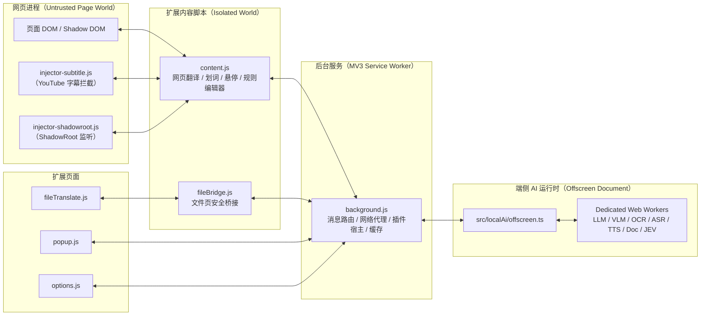
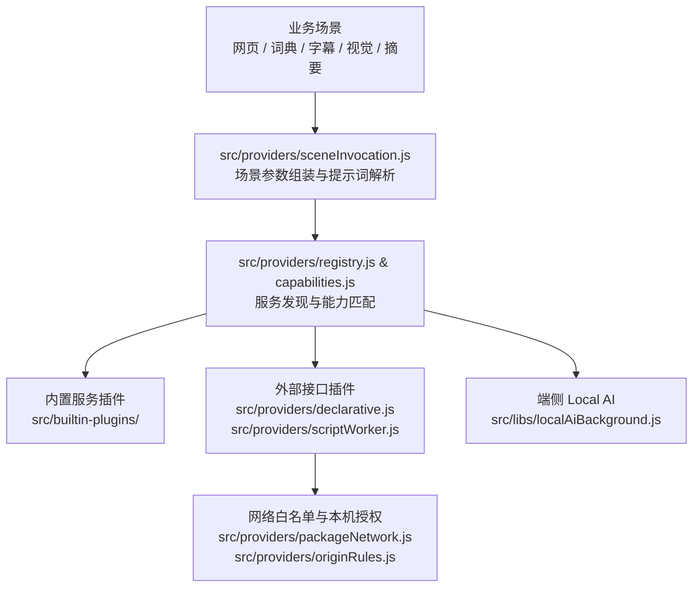
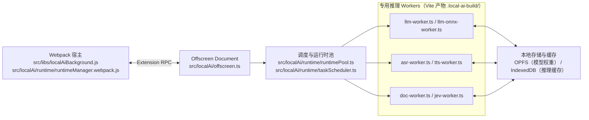
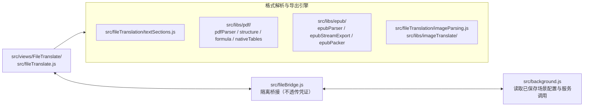

# KISS Translator 核心系统架构

本文档面向深入参与开发的工程师与 AI 编程助手，梳理 `fishjar/kiss-translator` 的多端运行拓扑、六大核心子系统职责边界与关键源码入口。

> 本地环境搭建、构建与测试命令请参阅 [DEVELOPER.md](DEVELOPER.md)；模块级协议细则请参阅 [prompt-template-contract.md](contracts/prompt-template-contract.md) 与 [image-parse-results.md](contracts/image-parse-results.md)。

---

## 1. 多端运行拓扑

本项目共用核心 React UI 与翻译调度逻辑，通过 `REACT_APP_CLIENT` 与 `config-overrides.js` 编译为三类运行形态：

### 运行形态边界对比

| 形态 | 主入口 | 网络与权限机制 | 能力范围 |
| :--- | :--- | :--- | :--- |
| **浏览器扩展（Chrome/Edge/Firefox/Thunderbird）** | `src/background.js`、`src/content.js`、`src/popup.js`、`src/options.js`、`src/fileTranslate.js` | MV3 Service Worker + `webextension-polyfill` | 全量能力：网页/输入/划词/独立窗、接口插件、Local AI、文件翻译、YouTube 字幕与 ASR |
| **油猴脚本（桌面 / iOS Safari）** | `src/userscript.js` + `src/libs/gm.js` | `GM_xmlhttpRequest`（受脚本管理器跨域弹窗约束） | 核心网页翻译、划词与规则同步；不含 Local AI、接口插件与文件翻译 |
| **Web / 首页与在线设置页** | `src/index.js`、`src/homepage/` | 浏览器标准 `fetch` | 项目首页、油猴在线设置页与文件翻译前端（需配合扩展桥接或云端服务） |

---

## 2. 统一服务与插件宿主架构

所有云端服务、内置模型、外部接口插件与端侧 Local AI 通过 `src/providers/` 统一抽象为**按能力（Capability）注册与调用**的运行时：

- **核心模块与职责**：
  - `src/providers/registry.js` / `capabilities.js` / `sceneInvocation.js`：统一注册表、能力声明（翻译、词典、字幕断句、视觉解析、ASR、TTS 等）与场景调用入口。
  - `src/providers/defaultPrompts.js` / `sdk/template.js`：提示词占位符展开与空模板回退（契约见 [prompt-template-contract.md](contracts/prompt-template-contract.md)）。
  - `src/providers/packageStore.js` / `packageNetwork.js` / `scriptWorker.js`：外部插件安装、声明式规则（`http` / `protocol`）与独立 Worker 脚本执行；网络请求受插件声明的域名白名单限制，授权状态仅存本机。
  - `src/builtin-plugins/`：内置云端服务（OpenAI、Gemini、Claude、DeepSeek、Google、Microsoft、DeepL、Ollama、Qwen-MT 等）的标准适配器。
  - **仓库边界**：官方外部插件源码与目录索引维护在独立仓库 `fishjar/kiss-translator-plugins`，本仓库仅维护宿主运行时、SDK 与通用测试样例。

---

## 3. 端侧 Local AI 推理架构

Local AI 采用 **Vite 独立构建 + Offscreen Document + 专用 Web Workers** 架构，避免将庞大的 ONNX/WASM/WebGPU 运行时耦合进 CRA 主打包流程：

- **双构建衔接**：`config-overrides.js` 将 `runtimeManager` 别名映射至 `src/localAi/runtime/runtimeManager.webpack.js`，实际推理产物由 `vite.config.local-ai.ts` 构建到 `.local-ai-build/`，并通过 `src/scripts/local-ai-cache.mjs` 做增量缓存。
- **关键源码入口**：
  - 模型目录与下载管理：`src/localAi/core/catalog.ts`、`downloadManager.ts`、`modelManager.ts`、`opfs.ts`
  - 硬件后端与内存调度：`src/localAi/core/deviceManager.ts`、`backendScheduler.ts`、`modelMemory.ts`
  - 推理结果缓存：`src/localAi/core/inferenceCache.ts`（缓存文本与结构化结果，不缓存二进制音视频/图片）

---

## 4. 文件与视觉翻译流水线

文件翻译模块支持 TXT、Markdown、PDF、EPUB 及图片（PNG/JPEG/WebP），将**前端解析/渲染**与**后台凭证/服务调用**严格隔离：

- **核心设计要点**：
  - `src/fileBridge.js` 与 `src/fileTranslation/protocol.js` 定义桥接协议：前端页面只声明任务类型与内容，不接触 API Key；由后台按当前保存的场景配置执行服务调用。
  - **视觉解析统一协议**：文件图片、网页图片、截图与 PDF 文字区域共享结构化视觉结果校验与译文复用逻辑（详见 [image-parse-results.md](contracts/image-parse-results.md)）。
  - **大文件与流式导出**：`src/fileTranslation/resultCache.js` 与 `src/libs/epub/epubStreamExport.js` 支持分阶段缓存与流式打包导出，避免大文档内存溢出。

---

## 5. YouTube 双语字幕与 ASR 流水线

YouTube 字幕模块横跨页面上下文与扩展隔离环境，支持原生字幕抓取、AI 语义断句以及可选的端侧/云端 ASR 语音转写：

- **字幕获取**：`src/injector-subtitle.js`（Firefox 辅以 `src/subtitleBootstrap.js`）在页面上下文拦截字幕轨道数据，交由 `src/subtitle/YouTubeCaptionProvider.js` 与 `src/subtitle/youtubeAcquisition.js` 解析（含 VTT 与 SABR 协议处理）。
- **合并与断句**：`src/subtitle/sentenceBreaker.js` 执行基础启发式合并，`src/subtitle/youtubeAiSegmentation.js` 与 `subtitleBoundaryProtocol.js` 负责 AI 语义断句与上下文衔接。
- **可选 ASR 管线**：`src/subtitle/asr/` 负责音频分片拉取（`sabrProtocol.js`、`aacDecoder.js`、`pcmPipeline.js`）、重采样（`resample.js`）、分片转写（`transcribeChunk.js`）与缓存恢复。
- **渲染与交互**：`src/subtitle/BilingualSubtitleManager.js`、`youtubePlayerUi.js`、`YouTubeSubtitleList.js` 与 `wordHover.js` 负责双语字幕叠加、字幕列表、悬停查词与生词收藏。

---

## 6. 存储、规则引擎与多端同步

- **网页翻译与规则引擎**：
  - `src/libs/translatorManager.js` / `translator.js` / `domManager.js`：负责 DOM 扫描、批量聚合队列（`batchQueue.js`）、视口交叉观察与富文本/Shadow DOM 渲染。
  - `src/libs/rules.js` & `src/libs/subRules.js`：实现三层规则覆盖优先级 **个人规则 > 订阅规则 > 全局规则**。
  - `src/libs/ruleEditor*.js`：可视化元素选择器，所有编辑在草稿态完成，保存后才落盘并触发同步。
- **存储协调与多端同步**：
  - `src/libs/storage.js` / `storageCoordination.js` / `storageSyncController.js`：统一封装扩展存储与状态一致性协调。
  - `src/libs/sync.js` & `src/libs/syncCrypto.js`：支持通过 `KISS-Worker` 或 WebDAV 进行全量配置同步与可选端到端加密。
- **诊断与隐私保护**：
  - `src/libs/diagnostics/`：统一日志采集与导出，`privacy.js` 负责对敏感凭据与令牌进行脱敏处理。
